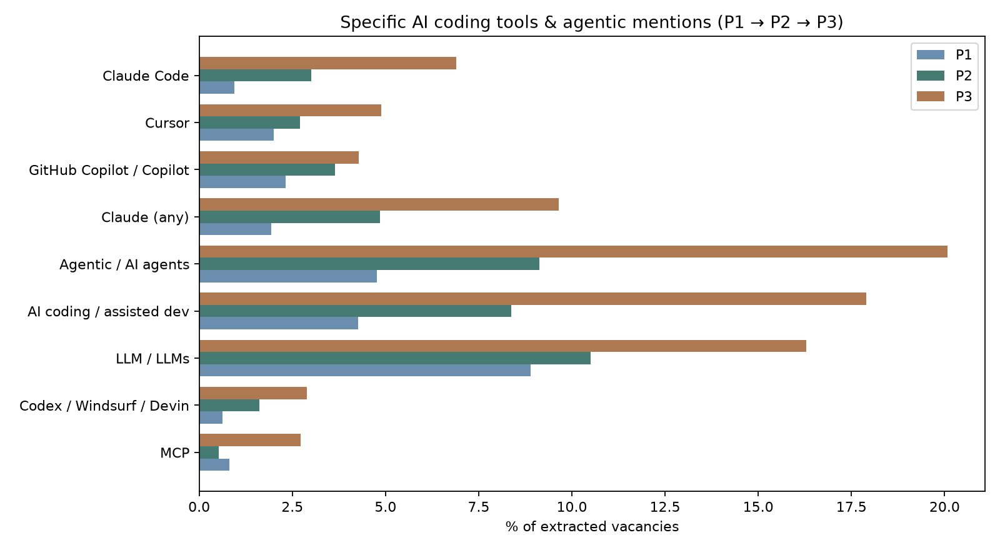
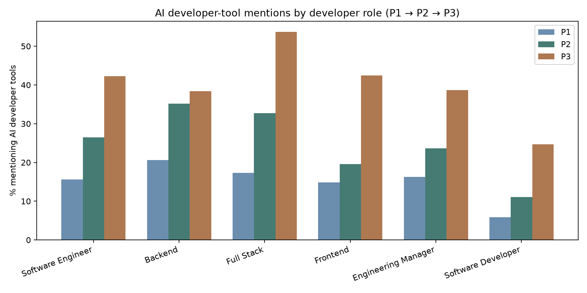
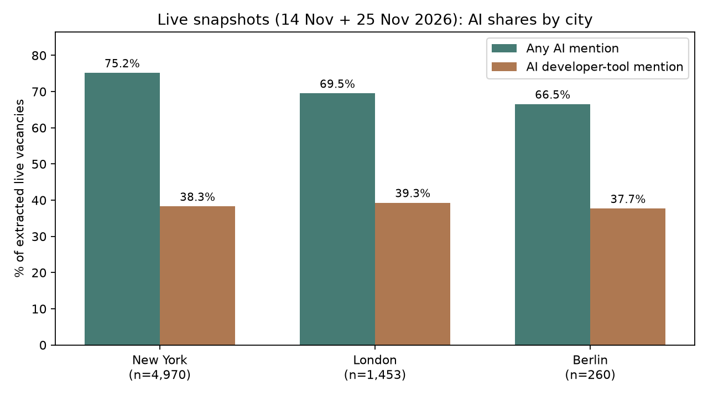

# Agentic Engineering Field Guide: Job Market Analysis (Nov 2025 – Nov 2026)

*Summary of structured LLM extraction (`glm-5.3-flash`, `jobs-v2`) across **18,386** software engineering vacancies (**17,625** unique after global repost deduplication), covering historical archives and the 14 Nov + 25 Nov 2026 live Built In snapshots in New York, London, and Berlin. Every figure below is traceable to [reports/TRENDS.md](reports/TRENDS.md), [reports/window-summary.json](reports/window-summary.json), and [reports/trends-breakdown.json](reports/trends-breakdown.json).*

## Why this matters for the Agentic Engineering course

The data draws a sharp line between **AI Engineering** (building AI/ML products) and **Agentic Engineering** (how software engineers build software with coding agents and AI developer tools):

- **AI developer-tool expectations more than 2.5×'d in one year**: from **16.40%** of extracted vacancies in late 2025 (**P1**, Nov–Dec 2025, `n=1,598`) to **27.58%** in spring 2026 (**P2**, Mar–May 2026, `n=1,733`) to **41.74%** in autumn 2026 (**P3**, Oct–Nov 2026, `n=3,670`) — a **+25.34 percentage point** jump.
- **Any explicit AI mention** rose from **51.19% → 59.90% → 76.65%** (+25.46 pp). Even restricting strictly to historical-origin postings (excluding live snapshots), developer-tool AI rose **16.31% → 27.60% → 42.13%**.
- **Momentum is still accelerating in late November 2026**: in the freshest live snapshot (**25 Nov**, `n=871`), **44.78%** of postings mention AI developer tools (vs. **37.79%** in the **14 Nov** snapshot, `n=6,190`).

**Course positioning takeaway:** You do not need to become an AI/ML researcher to be affected by this shift. Over **4 in 10** mainstream software engineering roles now explicitly expect fluency with AI coding tools and agentic workflows — and in Full Stack roles, it has already crossed **half of all postings**.

---

## 1. Agentic workflows and coding agents are the fastest-growing signal

| Tool / concept | P1 (Nov–Dec 2025, n=1,598) | P2 (Mar–May 2026, n=1,733) | P3 (Oct–Nov 2026, n=3,670) | Change (P3 − P1) | P3 dev-tool context |
|---|---:|---:|---:|---:|---:|
| **Agentic / AI agents** | 76 (4.76%) | 158 (9.12%) | 737 (20.08%) | **+15.32 pp** | 349 (9.51%) |
| **AI coding / assisted dev** | 68 (4.26%) | 145 (8.37%) | 657 (17.90%) | **+13.64 pp** | 628 (17.11%) |
| **Claude (any)** | 31 (1.94%) | 84 (4.85%) | 354 (9.65%) | **+7.71 pp** | 325 (8.86%) |
| **LLM / LLMs** | 142 (8.89%) | 182 (10.50%) | 598 (16.29%) | **+7.40 pp** | 113 (3.08%) |
| **Claude Code** | 15 (0.94%) | 52 (3.00%) | 253 (6.89%) | **+5.95 pp** | 239 (6.51%) |
| **Cursor** | 32 (2.00%) | 47 (2.71%) | 179 (4.88%) | **+2.88 pp** | 167 (4.55%) |
| **GitHub Copilot / Copilot** | 37 (2.32%) | 63 (3.64%) | 157 (4.28%) | **+1.96 pp** | 151 (4.11%) |
| **Codex / Windsurf / Devin** | 10 (0.63%) | 28 (1.62%) | 106 (2.89%) | **+2.26 pp** | 91 (2.48%) |
| **MCP** | 13 (0.81%) | 9 (0.52%) | 100 (2.72%) | **+1.91 pp** | 50 (1.36%) |

Key story angles for content and landing pages:
1. **Claude Code jumped 7× (0.94% → 6.89%)** to become the **#1 named coding agent**, overtaking both **Cursor** (4.88%) and **GitHub Copilot** (4.28%) by autumn 2026.
2. **"Agentic / AI agents" quadrupled (4.76% → 20.08%)**, and generic "AI coding / AI-assisted development" quadrupled (**4.26% → 17.90%**) — signaling a shift from autocomplete to agentic development loops.
3. **Emerging tooling is showing up in real JDs**: **Codex / Windsurf / Devin** (2.89%) and **MCP** (2.72%) are no longer niche Twitter terms; they appear in ~100+ P3 postings each.

---

## 2. All six developer roles are affected — led by Full Stack

| Developer role (title-based) | P1 dev-tool % (n) | P2 dev-tool % (n) | P3 dev-tool % (n) | Δ (P3 − P1) | P3 any AI % |
|---|---:|---:|---:|---:|---:|
| **Full Stack** | 17.29% (214) | 32.73% (278) | **53.74%** (454) | **+36.45 pp** | 79.30% |
| **Frontend** | 14.81% (135) | 19.61% (102) | **42.48%** (113) | **+27.67 pp** | 57.52% |
| **Software Engineer** | 15.62% (794) | 26.45% (930) | **42.27%** (2,148) | **+26.65 pp** | 80.40% |
| **Engineering Manager** | 16.29% (178) | 23.64% (165) | **38.63%** (409) | **+22.34 pp** | 77.02% |
| **Backend** | 20.58% (243) | 35.14% (222) | **38.41%** (289) | **+17.83 pp** | 67.47% |
| **Software Developer** | 5.88% (34) | 11.11% (36) | **24.68%** (77) | **+18.80 pp** | 46.75% |

- **Full Stack engineers** saw the steepest adoption (+36.45 pp), hitting **53.74%** in P3 — making Full Stack + Software Engineers the highest-intent audience for an Agentic Engineering course.
- **Engineering Managers** rose to **38.63%** (+22.34 pp): teams are hiring managers who can set standards, review workflows, and drive AI-assisted productivity across their orgs.
- **Core engineering fundamentals did not go away**: in P3, **Python (45.01%)**, **Communication (43.73%)**, **AWS (31.36%)**, **TypeScript (30.76%)**, **CI/CD (28.26%)**, **React (24.88%)**, **Kubernetes (23.73%)**, and **Distributed Systems (23.30%)** remain the backbone. Agentic Engineering is a multiplier on solid engineering, not a replacement for it.

---

## 3. London and Berlin match New York on AI developer-tool adoption

Across the deduplicated **14 Nov + 25 Nov 2026** Built In live snapshots (`7,094` rows):

| City | Unique n | Extracted n | Any AI % | Developer-tool AI % | Claude Code (dev) | Cursor (dev) | Copilot (dev) |
|---|---:|---:|---:|---:|---:|---:|---:|
| **New York** | 4,989 | 4,970 | 75.17% | **38.29%** | 293 (5.90%) | 221 (4.45%) | 161 (3.24%) |
| **London** | 1,458 | 1,453 | 69.51% | **39.30%** | 70 (4.82%) | 52 (3.58%) | 37 (2.55%) |
| **Berlin** | 266 | 260 | 66.54% | **37.69%** | 15 (5.77%) | 16 (6.15%) | 12 (4.62%) |

This directly supports promoting the Agentic Engineering course to European and DACH audiences (including Berlin/London): while "any AI" mentions are slightly higher in New York (75.2% vs. 66.5% in Berlin), **AI developer-tool adoption is virtually identical across all three hubs (~38–39%)**, and Berlin actually leads on Cursor (6.15%) and Copilot (4.62%) share.

---

## Methodology, caveats, and full artifacts

- **Extractor:** GLM-5.3-Flash (`glm-5.3-flash`, prompt `jobs-v2`, strict substring evidence grounding + conservative deterministic normalization). QA/SDET, interns, staff, and non-English vacancies are retained and tagged. **JobsPipe is not used.**
- **Deduplication & dating:** Global transitive deduplication by job ID, normalized URL, and company+title+location removes 761 repost rows; each unique vacancy is counted once at its earliest valid `posted_date` (never crawl/snapshot date).
- **Caveats for marketing copy:** These are descriptive sample shares from historical archives (Built In, Greenhouse, Ashby) plus Built In live snapshots, not census market volumes. Window durations differ (P1: 2 months, P2: 3 months, P3: ~2 months), summer 2026 is omitted, and live snapshots carry survivor bias. Quote shares ("41.7% of extracted P3 vacancies") rather than raw posting counts.
- **Independent corroboration:** A separate regex-based analysis of Hacker News *"Who is hiring?"* threads ([data/hn-hiring/REPORT.md](data/hn-hiring/REPORT.md), not mixed into this dataset) independently shows the same directional rise (any AI-tool keyword rising from 16% in Dec 2025 to 25–33% in Jun–Nov 2026, with Claude leading Cursor and Copilot).
- **Full reports & data:**
  - Snapshot reports: [P1 (Nov–Dec 2025)](reports/P1.md), [P2 (Mar–May 2026)](reports/P2.md), [P3 (Oct–Nov 2026)](reports/P3.md)
  - Trends & methodology: [TRENDS.md](reports/TRENDS.md), [monthly-by-role.csv](reports/monthly-by-role.csv), [PILOT_QA.md](reports/PILOT_QA.md)
  - Schema & compressed outputs: [SCHEMA.md](data/historical/extracted/SCHEMA.md), `data/historical/extracted/vacancies.jsonl.gz` (11,292 rows), `data/live/extracted/vacancies.jsonl.gz` (7,094 rows)
