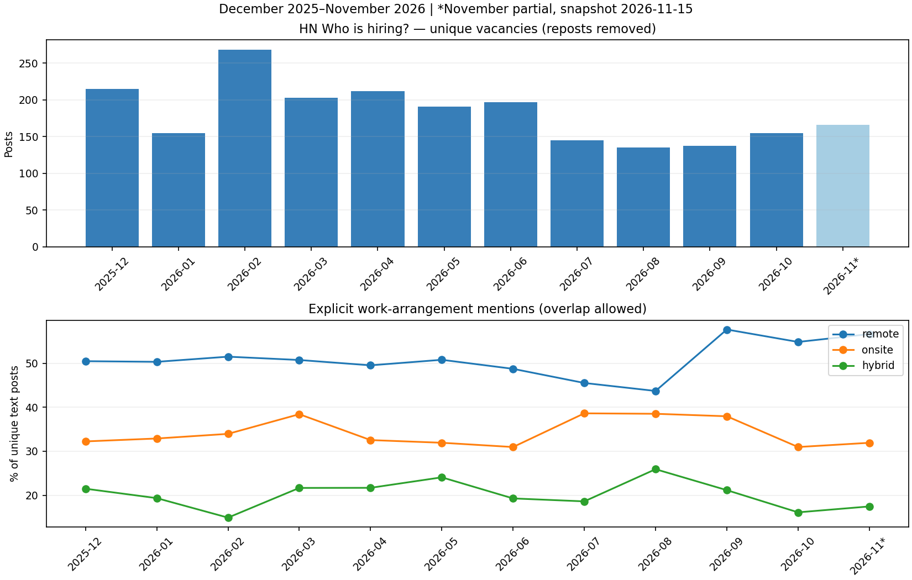
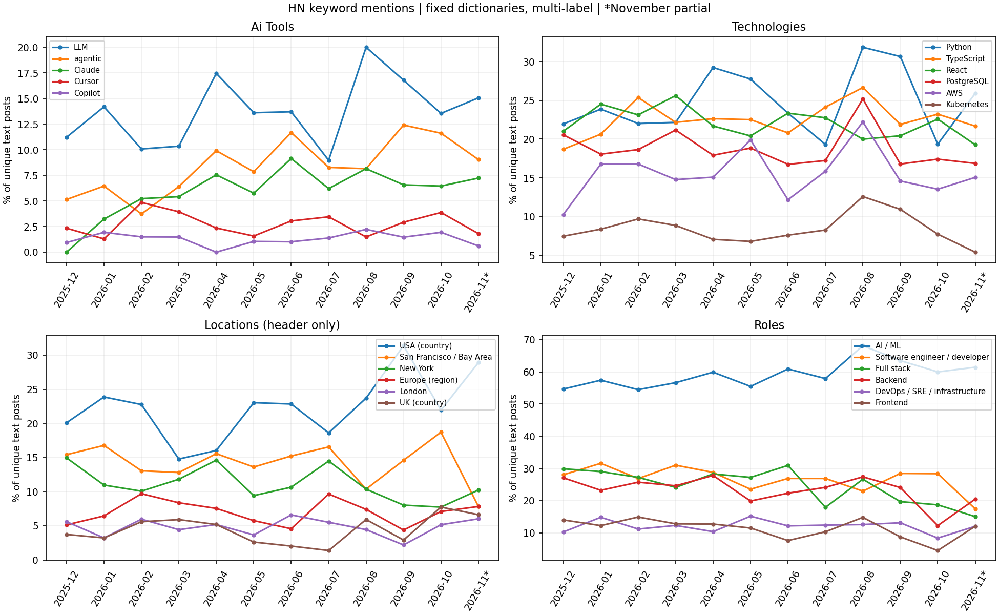

# HN “Ask HN: Who is hiring?” — last 12 monthly threads (Dec 2025 – Nov 2026)

Separate analysis, built **only** from Hacker News (Algolia API snapshot of 2026-11-15). It is not mixed into the historical/live jobs dataset (per Alexey, t3591u). November 2026 is a partial month (thread still open at snapshot).

## Method

- Threads: the 12 monthly `whoishiring` threads Dec 2025 – Nov 2026, discovered by paginated `search_by_date` (not ranked search); full comment trees from `items/<id>`. Raw gzip + SHA-256 in `raw/` and `manifest.json`.
- A vacancy post = a top-level comment (replies are not counted).
- **Dedup rule (Alexey, t3593u: publication date, no reposts).** Each vacancy is counted once, in the month of its *original* publication. A post is a repost if an earlier post (by `created_at`) has the same normalized company (first `|` field, legal suffixes stripped) **and** either the same set of other header fields (normalized, order-independent, with remote/onsite/hybrid/full-time/visa noise removed — i.e. same title + location) **or** the same deep job URL (host+path, no query). Same-month duplicates are removed too. To detect reposts of jobs first published *before* the window, the 12 earlier threads (Dec 2024 – Nov 2025) are fetched as a lookback used for dedup only and never counted.
- **Reposts removed: 1358 of 3537 top-level posts; 2179 unique vacancies remain.** All percentages below use unique text posts.
- Counting is pure regex (`patterns.json`, `analyze.py`); no LLM was used, so no GLM extractor is involved. Mentions are keyword hits, multi-label, not semantic classification. Locations use only the first header line.

## Monthly counts

| Month | Top-level posts | Reposts removed | Unique vacancies | Remote % | Onsite % | Hybrid % | Any AI tool % |
|---|---|---|---|---|---|---|---|
| 2025-12 | 378 | 163 | 215 | 50% | 32% | 21% | 16% |
| 2026-01 | 256 | 101 | 155 | 50% | 33% | 19% | 23% |
| 2026-02 | 410 | 142 | 268 | 51% | 34% | 15% | 18% |
| 2026-03 | 315 | 112 | 203 | 51% | 38% | 22% | 21% |
| 2026-04 | 326 | 114 | 212 | 50% | 33% | 22% | 26% |
| 2026-05 | 317 | 126 | 191 | 51% | 32% | 24% | 23% |
| 2026-06 | 312 | 115 | 197 | 49% | 31% | 19% | 28% |
| 2026-07 | 255 | 110 | 145 | 46% | 39% | 19% | 23% |
| 2026-08 | 224 | 89 | 135 | 44% | 39% | 26% | 33% |
| 2026-09 | 247 | 110 | 137 | 58% | 38% | 21% | 31% |
| 2026-10 | 253 | 98 | 155 | 55% | 31% | 16% | 27% |
| 2026-11* | 244 | 78 | 166 | 57% | 32% | 17% | 25% |

\* partial month. Remote/onsite/hybrid are explicit keyword mentions and overlap; “not remote”-style negations are stripped.

## AI tool mentions (unique posts per month)

| Tool | 25-12 | 26-01 | 26-02 | 26-03 | 26-04 | 26-05 | 26-06 | 26-07 | 26-08 | 26-09 | 26-10 | 26-11 | Total |
|---|---|---|---|---|---|---|---|---|---|---|---|---|---|
| LLM | 24 | 22 | 27 | 21 | 37 | 26 | 27 | 13 | 27 | 23 | 21 | 25 | 293 |
| agentic | 11 | 10 | 10 | 13 | 21 | 15 | 23 | 12 | 11 | 17 | 18 | 15 | 176 |
| Claude | 0 | 5 | 14 | 11 | 16 | 11 | 18 | 9 | 11 | 9 | 10 | 12 | 126 |
| Cursor | 5 | 2 | 13 | 8 | 5 | 3 | 6 | 5 | 2 | 4 | 6 | 3 | 62 |
| Copilot | 2 | 3 | 4 | 3 | 0 | 2 | 2 | 2 | 3 | 2 | 3 | 1 | 27 |

## Top locations, roles, technologies (12-month totals, unique posts)

- **Locations (header):** USA (country) (478), San Francisco / Bay Area (309), New York (245), Europe (region) (154), London (108), UK (country) (97), Canada (country) (81), Berlin (54)
- **Roles:** AI / ML (1278), Software engineer / developer (585), Full stack (547), Backend (512), DevOps / SRE / infrastructure (261), Frontend (253), Management / leadership (230), Data (132)
- **Technologies:** Python (535), TypeScript (490), React (483), PostgreSQL (409), AWS (336), Kubernetes (181), Rust (162), Go (160)

Per-month numbers for every label: `counts_mentions.csv`; per-post audit rows: `posts.jsonl` (including `duplicate`, `original_id`, `original_month`).

## Findings

- Volume is falling: unique vacancies peak at 268 in Feb 2026 and run 135–166 per month from July onward (Dec 2025: 215; Nov 2026 so far: 166, partial).
- Reposting is large: ~38% of top-level posts are re-listings (1358 of 3537); counting them would overstate demand in every month.
- Remote stays the most-mentioned arrangement (about half of unique posts; see table) with a dip to 44% in Aug and 55–58% in Sep–Nov 2026.
- AI-tool mentions are rising as a share of a shrinking pool: any AI-tool keyword appears in 16% of unique posts in Dec 2025 vs 25–33% in Jun–Nov 2026. “LLM” is the most common AI term, “agentic” is in 10–23 unique posts per month, Claude is named in ~10–18 per month since Feb 2026, Copilot stays marginal.

## Caveats

- Dedup is heuristic: a company that rewrites its header evades it (undercounts reposts); generic headers like “Company | Remote” collapse distinct roles at one company (overcounts reposts). Posts without a `|` header are deduped by deep URL only.
- HN hiring threads are a self-selected, startup/tech-skewed sample, not the job market.
- The “AI / ML” role label is a broad keyword (`AI`, `ML`, …) and matches many non-AI-titled posts.

## Reproduce

`python analyze.py --charts` (offline, verifies hashes; `--collect` refreshes from Algolia). `python -m unittest discover -s . -p 'test_*.py'`. CI: `.github/workflows/hn-hiring.yml`.
