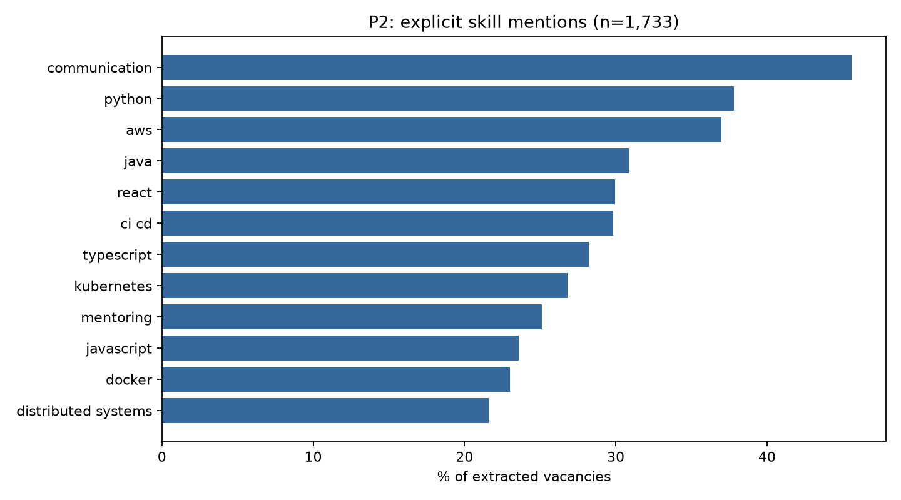

# P2: original publication 2026-03-01 to 2026-05-31

Unique vacancies: **1,755**; successful LLM extractions: **1,733**; missing description/extraction: 22.
Repost observations removed for jobs originally published in this window: **108**.
Repost observations with their own listed posted date in this window, excluded from new vacancy counts: **111**.
Sources: {"builtin": 1755}; input cohorts: {"historical": 1754, "live": 1}.

## Requirements and skills

| field | n | % of extracted vacancies |
|---|---:|---:|
| communication | 790 | 45.59% |
| python | 655 | 37.80% |
| aws | 641 | 36.99% |
| java | 535 | 30.87% |
| react | 519 | 29.95% |
| ci cd | 517 | 29.83% |
| typescript | 489 | 28.22% |
| kubernetes | 465 | 26.83% |
| mentoring | 435 | 25.10% |
| javascript | 409 | 23.60% |
| docker | 399 | 23.02% |
| distributed systems | 374 | 21.58% |
| microservices | 339 | 19.56% |
| c | 330 | 19.04% |
| sql | 314 | 18.12% |
| agile | 313 | 18.06% |
| go | 261 | 15.06% |
| collaboration | 249 | 14.37% |
| git | 243 | 14.02% |
| node js | 240 | 13.85% |

## AI mentions

Any explicit AI mention: 1038 / 1733 (59.9%); developer tooling: 478 / 1733 (27.58%). AI product work is counted separately from developer tools in the extracted data.

| field | n | % of extracted vacancies |
|---|---:|---:|
| ai | 557 | 32.14% |
| machine learning | 201 | 11.60% |
| llm | 126 | 7.27% |
| ai ml | 80 | 4.62% |
| generative ai | 60 | 3.46% |
| agentic ai | 59 | 3.40% |
| ai agents | 58 | 3.35% |
| claude code | 52 | 3.00% |
| genai | 50 | 2.89% |
| cursor | 47 | 2.71% |
| ai tools | 44 | 2.54% |
| artificial intelligence | 42 | 2.42% |
| llms | 41 | 2.37% |
| github copilot | 38 | 2.19% |
| rag | 32 | 1.85% |
| ai assisted development | 29 | 1.67% |
| claude | 27 | 1.56% |
| copilot | 26 | 1.50% |
| ai assisted development tools | 19 | 1.10% |
| ai coding assistants | 19 | 1.10% |

## Roles and seniority

| field | n | % of extracted vacancies |
|---|---:|---:|
| software_engineer | 445 | 25.68% |
| backend | 426 | 24.58% |
| fullstack | 418 | 24.12% |
| engineering_manager | 175 | 10.10% |
| frontend | 120 | 6.92% |
| devops_sre | 46 | 2.65% |
| qa_sdet | 39 | 2.25% |
| other | 33 | 1.90% |
| data_ml | 26 | 1.50% |
| unknown | 5 | 0.29% |

| field | n | % of extracted vacancies |
|---|---:|---:|
| senior | 676 | 39.01% |
| unknown | 480 | 27.70% |
| staff | 196 | 11.31% |
| manager | 173 | 9.98% |
| lead | 94 | 5.42% |
| principal | 57 | 3.29% |
| intern | 36 | 2.08% |
| mid | 12 | 0.69% |
| junior | 9 | 0.52% |

QA/SDET tagged: 42; interns: 36; staff: 202; non-English: 1.

## Experience, workplace and pay

Explicit minimum experience: 1365 / 1733; explicit salary: 751 / 1733. Missing means unspecified, never zero. Salary amounts/currency/period remain in individual rows; no cross-currency average.

| field | n | % of extracted vacancies |
|---|---:|---:|
| unknown | 729 | 42.07% |
| remote | 471 | 27.18% |
| hybrid | 438 | 25.27% |
| office | 95 | 5.48% |

## Counting and caveats

Jobs are joined transitively by same source job ID, normalized URL (without query/fragment/trailing slash), or Unicode/case/punctuation-normalized company + title + sorted unique location list. Each entity counts once at the earliest known posted_date across both inputs. This proxy can merge distinct openings with identical titles/locations; employer aliases are not guessed. Different location sets stay distinct unless ID/URL joins them. Later repost descriptions do not replace earlier requirements.

Capture dates, crawl months and snapshot dates are never used as publication dates. 0 crawl_batch rows are included because they have a real posted_date in this window. Undated entities are excluded. P3 combines historical October with the November 14 and November 25 live snapshots (London, Berlin, New York). Live snapshots contain older active jobs, assigned to their original publication windows. Archives and live survivor snapshots have different selection biases. These are descriptive sample shares, not market vacancy volumes or causal trends. See [TRENDS](TRENDS.md) for defaults, audit and source sensitivity.

## Six developer roles (title-based)

| role | vacancies | extracted | any AI n | any AI % | developer tools n | developer tools % |
|---|---:|---:|---:|---:|---:|---:|
| Software Engineer | 936 | 930 | 566 | 60.86% | 246 | 26.45% |
| Backend | 227 | 222 | 138 | 62.16% | 78 | 35.14% |
| Full Stack | 286 | 278 | 178 | 64.03% | 91 | 32.73% |
| Frontend | 104 | 102 | 50 | 49.02% | 20 | 19.61% |
| Engineering Manager | 166 | 165 | 96 | 58.18% | 39 | 23.64% |
| Software Developer | 36 | 36 | 10 | 27.78% | 4 | 11.11% |

## Role breakdown (LLM-extracted)

| role | vacancies | extracted | any AI % | developer tools % | experience disclosed % | salary disclosed % |
|---|---:|---:|---:|---:|---:|---:|
| backend | 426 | 426 | 61.03 | 29.81 | 80.28 | 47.89 |
| data_ml | 26 | 26 | 80.77 | 15.38 | 76.92 | 46.15 |
| devops_sre | 46 | 46 | 63.04 | 36.96 | 80.43 | 52.17 |
| engineering_manager | 175 | 175 | 61.71 | 27.43 | 86.29 | 53.71 |
| frontend | 120 | 120 | 46.67 | 17.5 | 80.0 | 25.0 |
| fullstack | 418 | 418 | 65.31 | 33.97 | 84.45 | 33.73 |
| other | 33 | 33 | 42.42 | 9.09 | 66.67 | 45.45 |
| qa_sdet | 39 | 39 | 41.03 | 20.51 | 74.36 | 51.28 |
| software_engineer | 445 | 445 | 58.2 | 24.04 | 70.79 | 47.42 |
| unknown | 27 | 5 | 40.0 | 20.0 | 0.0 | 0.0 |

[Monthly requirements/AI/seniority/workplace by role](monthly-by-role.csv) includes explicit numerators and denominators; small cells are unstable.

Median explicit minimum experience: 5 years (n=1365 disclosures). This is conditional on disclosure.

| currency | period | disclosed minimum-pay n | median lower bound |
|---|---|---:|---:|
| BDT | month | 1 | 160,000.00 |
| EUR | month | 1 | 4,200.00 |
| EUR | year | 11 | 85,000.00 |
| GBP | year | 1 | 133,000.00 |
| PLN | hour | 1 | 147.00 |
| PLN | month | 1 | 12,600.00 |
| USD | hour | 3 | 29.00 |
| USD | year | 37 | 150,000.00 |
