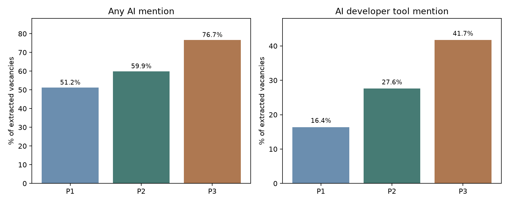
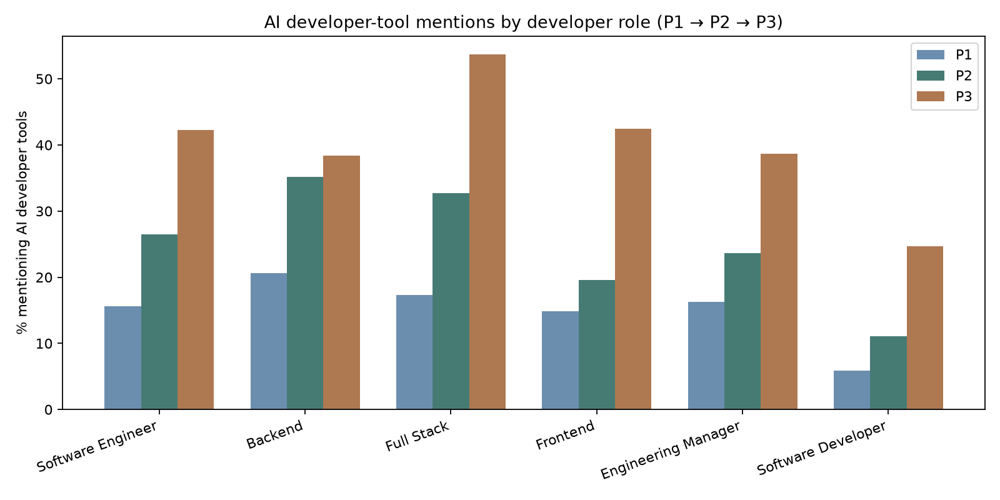
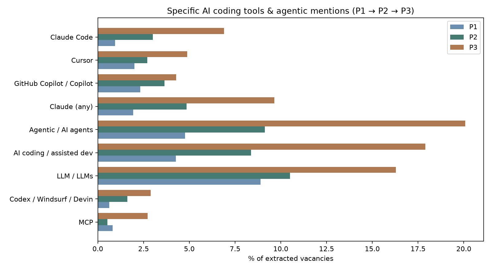
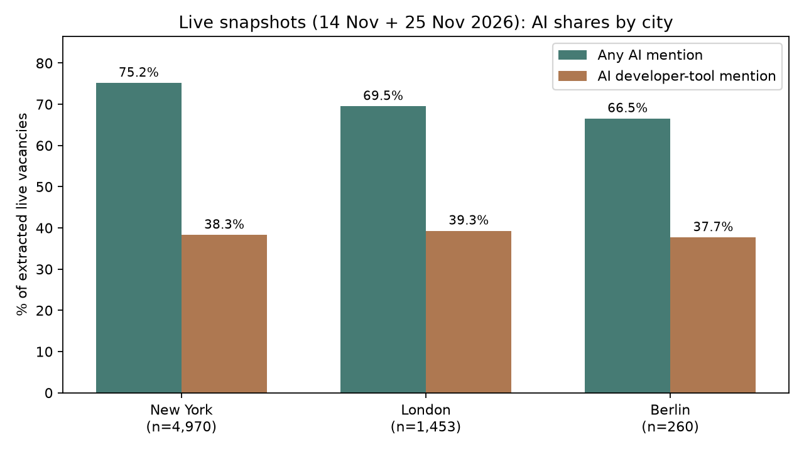

# Three snapshots: requirements and AI mentions

These windows use original publication dates after global repost deduplication. Each vacancy counts once. Full row lineage is in `dedup-audit.jsonl.gz`; the extraction outputs retain all source rows and tag reposts through this audit.

| window | unique n | extracted n | removed reposts (original window) | any AI % | developer-tool AI % |
|---|---:|---:|---:|---:|---:|
| [P1](P1.md) | 1616 | 1598 | 125 | 51.19 | 16.4 |
| [P2](P2.md) | 1755 | 1733 | 108 | 59.9 | 27.58 |
| [P3](P3.md) | 3687 | 3670 | 76 | 76.65 | 41.74 |

## Interpretation

Any AI mentions: 51.19% → 59.9% → 76.65%; P3 minus P1 = +25.46 percentage points. Developer-tool AI mentions: 16.4% → 27.58% → 41.74%; P3 minus P1 = +25.34 percentage points. These sample changes cannot separate hiring changes from source/role mix, archive availability and live-survivor selection. The windows have unequal duration (two, three, and an incomplete two months), so raw counts do not measure market growth. Summer is intentionally omitted.

## Six developer roles: AI & developer-tool requirements (P1 → P2 → P3)

| role | P1 n | P1 any AI % | P1 dev-tool % | P2 n | P2 any AI % | P2 dev-tool % | P3 n | P3 any AI % | P3 dev-tool % | dev-tool Δ (P3−P1) |
|---|---:|---:|---:|---:|---:|---:|---:|---:|---:|---:|
| Software Engineer | 794 | 50.76% | 15.62% | 930 | 60.86% | 26.45% | 2148 | 80.40% | 42.27% | +26.65 pp |
| Backend | 243 | 55.97% | 20.58% | 222 | 62.16% | 35.14% | 289 | 67.47% | 38.41% | +17.83 pp |
| Full Stack | 214 | 53.74% | 17.29% | 278 | 64.03% | 32.73% | 454 | 79.30% | 53.74% | +36.45 pp |
| Frontend | 135 | 41.48% | 14.81% | 102 | 49.02% | 19.61% | 113 | 57.52% | 42.48% | +27.67 pp |
| Engineering Manager | 178 | 53.93% | 16.29% | 165 | 58.18% | 23.64% | 409 | 77.02% | 38.63% | +22.34 pp |
| Software Developer | 34 | 35.29% | 5.88% | 36 | 27.78% | 11.11% | 77 | 46.75% | 24.68% | +18.80 pp |

## Agentic & AI coding tools over time (P1 → P2 → P3)

| tool / concept | P1 n (%) | P2 n (%) | P3 n (%) | Δ (P3−P1) | P3 dev-tool context n (%) |
|---|---:|---:|---:|---:|---:|
| Claude Code | 15 (0.94%) | 52 (3.00%) | 253 (6.89%) | +5.95 pp | 239 (6.51%) |
| Cursor | 32 (2.00%) | 47 (2.71%) | 179 (4.88%) | +2.88 pp | 167 (4.55%) |
| GitHub Copilot / Copilot | 37 (2.32%) | 63 (3.64%) | 157 (4.28%) | +1.96 pp | 151 (4.11%) |
| Claude (any) | 31 (1.94%) | 84 (4.85%) | 354 (9.65%) | +7.71 pp | 325 (8.86%) |
| Agentic / AI agents | 76 (4.76%) | 158 (9.12%) | 737 (20.08%) | +15.32 pp | 349 (9.51%) |
| AI coding / assisted dev | 68 (4.26%) | 145 (8.37%) | 657 (17.90%) | +13.64 pp | 628 (17.11%) |
| LLM / LLMs | 142 (8.89%) | 182 (10.50%) | 598 (16.29%) | +7.40 pp | 113 (3.08%) |
| Codex / Windsurf / Devin | 10 (0.63%) | 28 (1.62%) | 106 (2.89%) | +2.26 pp | 91 (2.48%) |
| MCP | 13 (0.81%) | 9 (0.52%) | 100 (2.72%) | +1.91 pp | 50 (1.36%) |

## Live snapshots: London, Berlin, New York (14 Nov + 25 Nov 2026)

Both Built In live snapshots (`2026-11-14` and `2026-11-25`) are included in the global dataset (each vacancy assigned to its earliest `posted_date` across windows). Below is the city-level summary across deduplicated live-snapshot vacancies:

| snapshot | rows | extracted n | any AI % | developer-tool AI % |
|---|---:|---:|---:|---:|
| 2026-11-14 | 6,215 | 6,190 | 73.15% | 37.79% |
| 2026-11-25 | 879 | 871 | 76.58% | 44.78% |

| city (14 Nov + 25 Nov deduped) | unique n | extracted n | any AI % | developer-tool AI % | Claude Code (dev) | Cursor (dev) | Copilot (dev) |
|---|---:|---:|---:|---:|---:|---:|---:|
| New York | 4,989 | 4,970 | 75.17% | 38.29% | 293 (5.90%) | 221 (4.45%) | 161 (3.24%) |
| London | 1,458 | 1,453 | 69.51% | 39.30% | 70 (4.82%) | 52 (3.58%) | 37 (2.55%) |
| Berlin | 266 | 260 | 66.54% | 37.69% | 15 (5.77%) | 16 (6.15%) | 12 (4.62%) |

## Conservative defaults

- Reposts are retained as extraction rows and flagged in the audit, then excluded from all report counts. The latest user instruction supersedes the earlier keep-and-count proposal.
- Date is the earliest valid posted_date in each linked entity. Missing publication dates never fall back to crawl_batch/capture/snapshot. Crawl_batch rows with posted_date remain eligible.
- First location region is retained with regions_all, without exploding jobs into multiple counts. Historical UNKNOWN buckets remain unknown. Live regions use the same deterministic mapping.
- QA/SDET, interns, staff, other engineering roles and non-English rows are retained and tagged. Language is extracted; tags also use title/employment metadata.
- Employer names are normalized for case/punctuation but aliases/board slugs are not guessed. Text twins with different company/title/location remain distinct unless ID/URL links them. Extraction itself runs once per unique cleaned text, independently of vacancy counting.
- EEO, applicant privacy, board tags and standalone About us/company/team paragraphs are stripped before extraction. Requirement paragraphs containing legal/privacy vocabulary can be over-stripped; raw inputs remain unchanged. All evidence refers to the stripped text.
- No JobsPipe access, data or credentials are used. Inputs are historical Built In/Greenhouse/Ashby and the existing Built In live snapshots only.
- Shares use successful extractions in the window as denominator; n and missing counts are explicit. Missing fields are unknown, not negative evidence of absence. Multi-label skills and AI names can sum above 100%.
- Salary retains currency/period and no inferred currency or annualization. Experience is explicit candidate work experience. Remote/office comes from description, with unknown retained.

## Input provenance and extraction

Historical: `data/historical/clean/vacancies.jsonl.gz` (11,292 frozen rows from 15 Nov run, SHA-256 `7b61296d...`). Live: `alexeygrigorev/agentic-engineering-field-guide` commits `59126d538145ec21faed82bc648cbd5536048de3` (`2026-11-14`, 6,215 rows) and `79ec4c0` (`2026-11-25`, 879 rows), joined by ID to `data/live/data_raw/<date>/*.yaml`. A missing detail file is an explicit missing-description row, never filled from listing title. Validation-failed rows (`status="error"`, <1% of corpus) remain explicit and are excluded from LLM-share denominators.

Model: GLM-5.3-Flash (`glm-5.3-flash`) via existing Z.ai Coding Plan configuration. Content-hash cache and request IDs/token usage are retained; schema and reproduction instructions are in the extraction schema document. See pilot QA and cost report.

Global dedup: 18,386 input rows → 17,625 entities; 761 repost rows removed; 48 entities lack publication date.

## Source sensitivity: historical-origin entities only

| window | n | any AI % | developer-tool AI % |
|---|---:|---:|---:|
| P1 | 1612 | 51.13 | 16.31 |
| P2 | 1754 | 59.93 | 27.6 |
| P3 | 198 | 69.54 | 42.13 |

This check excludes live-origin entities while keeping global deduplication. It does not remove archive selection bias. Full role, seniority, requirements, work arrangements and disclosure counts are shown in each window report.

## Requirements, seniority and workplace comparison

Skills count any explicit skill mention; requirement levels are retained separately in monthly-by-role.csv and each extracted row. Alternatives/examples can be inconsistently classified as required/preferred/mentioned, so skill mention shares are the primary comparable measure. All cells are percentages of successful extractions, independently within each window. Skill names are normalized only for case/punctuation; aliases can split counts.

| measure | P1 % | P2 % | P3 % |
|---|---:|---:|---:|
| skills: aws | 35.61 | 36.99 | 31.36 |
| skills: c | 17.46 | 19.04 | 15.78 |
| skills: ci cd | 28.29 | 29.83 | 28.26 |
| skills: communication | 46.5 | 45.59 | 43.73 |
| skills: distributed systems | 19.4 | 21.58 | 23.3 |
| skills: docker | 20.46 | 23.02 | 15.53 |
| skills: go | 16.33 | 15.06 | 17.08 |
| skills: java | 31.35 | 30.87 | 23.19 |
| skills: javascript | 23.09 | 23.6 | 15.75 |
| skills: kubernetes | 24.22 | 26.83 | 23.73 |
| skills: mentoring | 24.91 | 25.1 | 22.92 |
| skills: python | 38.86 | 37.8 | 45.01 |
| skills: react | 30.85 | 29.95 | 24.88 |
| skills: sql | 17.58 | 18.12 | 15.4 |
| skills: typescript | 26.1 | 28.22 | 30.76 |
| seniority: intern | 2.38 | 2.08 | 1.44 |
| seniority: junior | 0.81 | 0.52 | 0.65 |
| seniority: lead | 6.51 | 5.42 | 4.36 |
| seniority: manager | 11.51 | 9.98 | 14.99 |
| seniority: mid | 0.56 | 0.69 | 0.79 |
| seniority: principal | 2.88 | 3.29 | 4.03 |
| seniority: senior | 36.55 | 39.01 | 28.91 |
| seniority: staff | 9.64 | 11.31 | 11.17 |
| seniority: unknown | 29.16 | 27.7 | 33.65 |
| workplace: hybrid | 24.84 | 25.27 | 21.83 |
| workplace: office | 4.44 | 5.48 | 5.72 |
| workplace: remote | 30.16 | 27.18 | 31.77 |
| workplace: unknown | 40.55 | 42.07 | 40.68 |
| Experience disclosure | 78.91 | 78.77 | 68.12 |
| Salary disclosure | 43.24 | 43.34 | 51.31 |

[Monthly data by role](monthly-by-role.csv) contains all observed months with numerators, denominators, skills, AI mentions, seniority, workplace and disclosure shares. No summer interpolation is performed. Salary and experience summaries are conditional on disclosure and are in each window report; changing disclosure rates prevent treating them as unconditional market estimates.
